# Plot gallery

Every function of `sparc.plots` takes an explanation, or one instance of it (`explanation[i]`), draws with matplotlib and returns the axes. `ax=` draws into an existing axes, `show=True` displays the figure. Retained concepts are marked with an asterisk in the axis labels. The figures come from the [regression tutorial](tutorials/regression.md).

## Importance and attribution

| Plot | Question it answers | Figure |
|---|---|---|
| `bar(e)` | Which concepts matter over the explained instances, and how uncertain is their importance? | 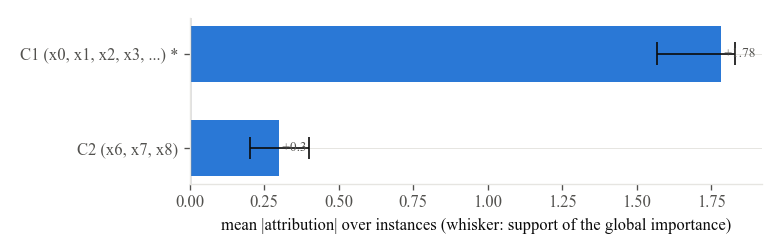 |
| `bar(e[i])` | Which concepts drive this prediction, with the support of every attribution? | |
| `beeswarm(e)` | How does every concept's attribution vary across instances, and with the concept score? | 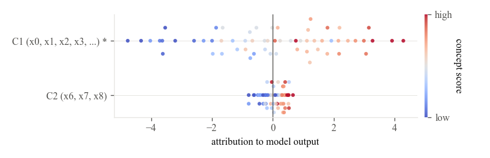 |
| `heatmap(e)` | Instances by concepts, ordered by the model output. | 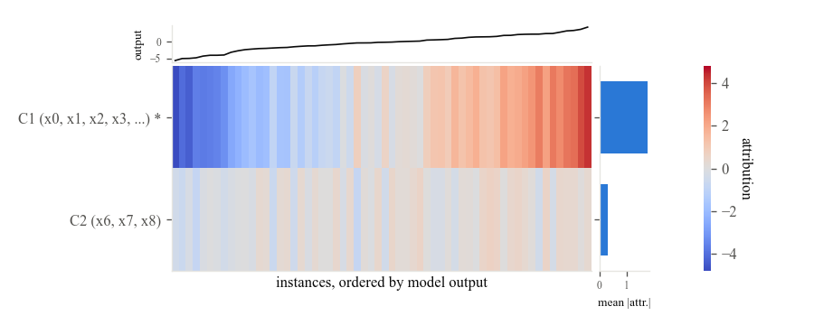 |
| `dependence(e, concept)` | How does a concept's attribution depend on its score, and on which other concept? | 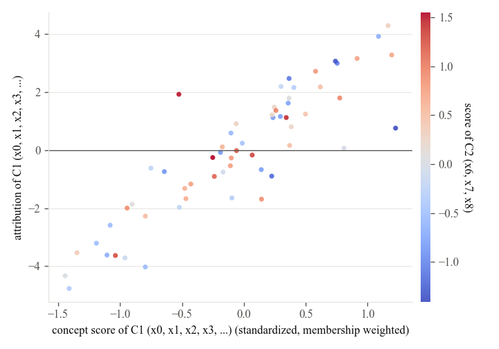 |

## One instance

| Plot | Question it answers | Figure |
|---|---|---|
| `waterfall(e[i])` | How does the prediction build up from the base value, concept by concept? | 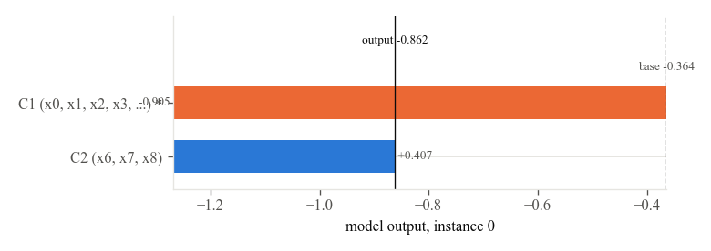 |
| `force(e[i])` | Which concepts push the output up and which down? | 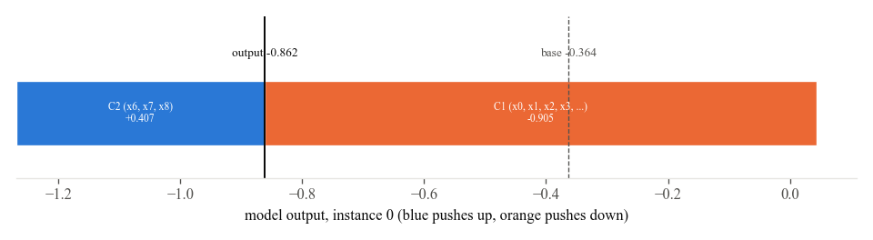 |
| `interval_bars(e[i])` | What is each attribution, how wide are its core and support, how confident is its sign, do the model classes agree? |  |
| `fuzzy_attribution(e, i)` | The membership functions of the attributions, with type 2 bands where the model classes disagree. | 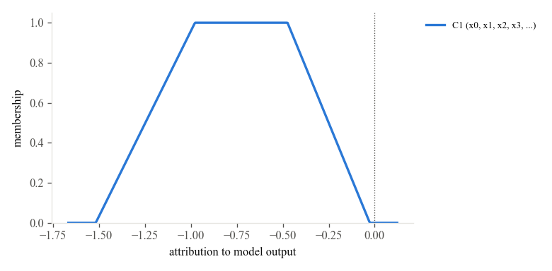 |
| `linguistic_bars(e, i)` | The bars with the linguistic label of every concept written beside them. | |
| `linguistic_profile(e[i])` | How compatible is every label with every attribution? | 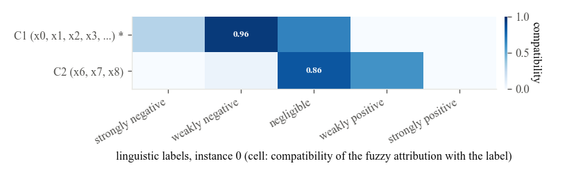 |
| `disagreement(e[i])` | What does every model class say, resample by resample? | 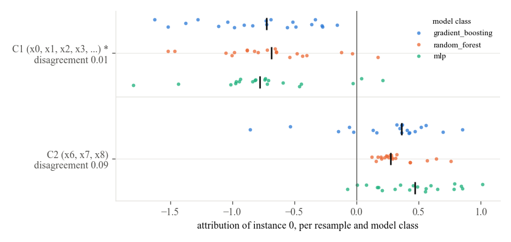 |

## All instances together

| Plot | Question it answers | Figure |
|---|---|---|
| `decision(e)` | The cumulative path of every instance from the base value to its output. | 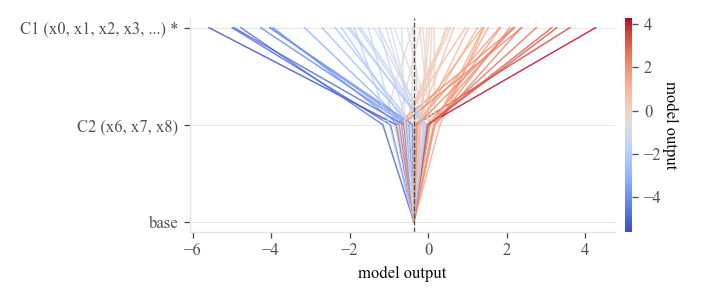 |
| `coverage(e, replicate)` | Do the intervals cover an independent replicate at their nominal levels? | 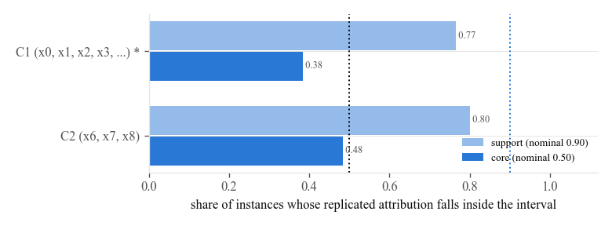 |

## The concepts

| Plot | Question it answers | Figure |
|---|---|---|
| `membership(e.partition)` | Which features belong to which concept, and to what degree? | 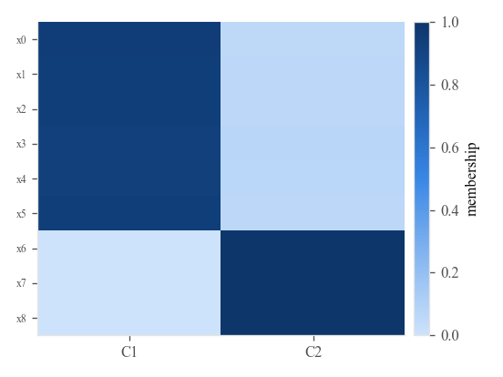 |
| `concept_graph(e)` | The partition as a picture: features placed by their correlation profiles, coloured by membership. | 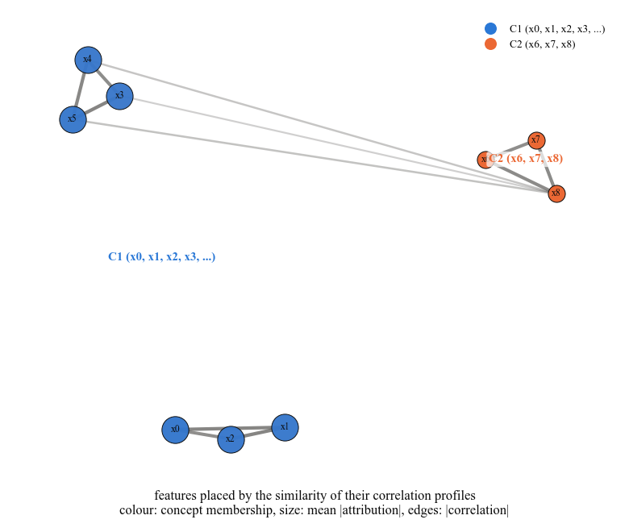 |

## The front

| Plot | Question it answers | Figure |
|---|---|---|
| `front(e)` | Where do the knee, the fidelity optimal member and the current explanation sit among all configurations? | 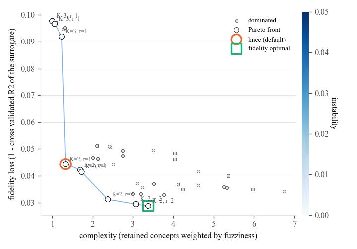 |
| `front_navigator(e, i)` | How does the explanation change along the front, from the sparsest to the most faithful member? | 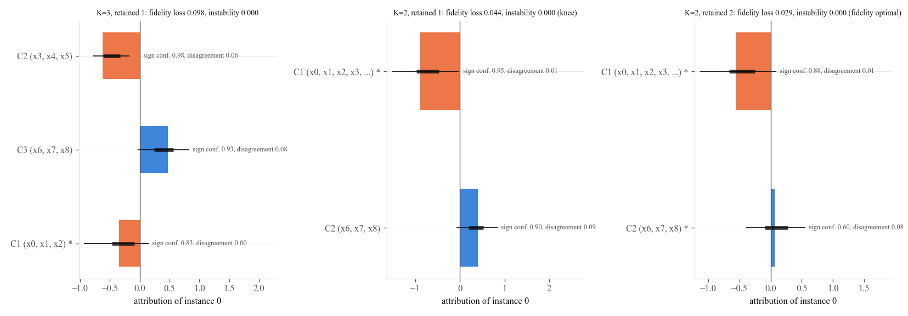 |
| `selection_membership(e)` | How often does the front retain every concept and every feature? | 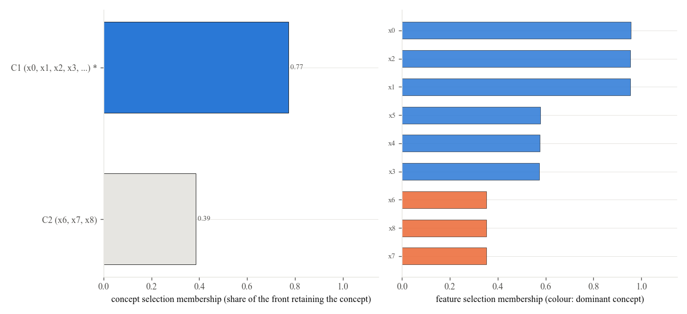 |
| `pareto_front(e.configurations)` | The plain front of a configuration table. | |

## Conventions

Blue is a positive attribution, orange a negative one. Thin lines are supports (the central 90 percent of the pool by default), thick lines cores (the central 50 percent). Colour scales for concept scores run from blue (low) to red (high).
