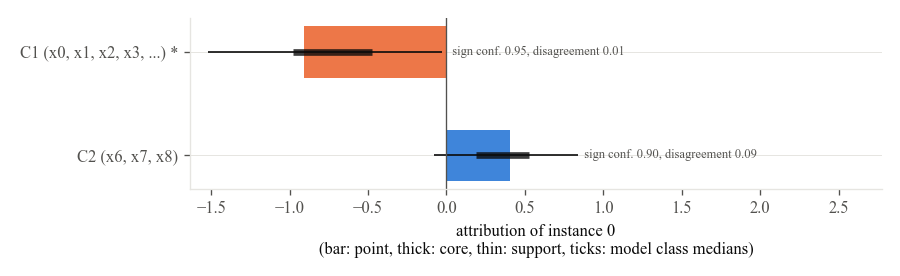

<p align="center"></p>

# SPARC

**Shapley Pareto Robust Concept attribution with fuzzy logic.** Post hoc explanations of tabular black box models that are stable, calibrated and sparse.

Charis Ntakolia, Department of Aeronautical Studies, Hellenic Air Force Academy.

```
pip install "sparc-xai[plots]"
```

SPARC attributes a prediction to **fuzzy concepts of correlated features** instead of to single features, so that the credit of a prediction is not split arbitrarily among features that carry the same information. Every attribution is estimated over bootstrap resamples and several model classes and reported as a **trapezoidal fuzzy number** with a sign confidence, a disagreement index between model classes and a **linguistic label** such as *weakly positive*. The number of concepts, the fuzzifier, the sparsity and the alpha level are selected from a **Pareto front** that trades off fidelity loss, complexity and instability; a knee point is reported by default and the whole front is kept, so that the sparse default and the most faithful explanation are both one call away.



## What you get

| Output | Where |
|---|---|
| Point attribution of every concept, measured from a base value, summing to the model output | `explanation.values`, `explanation.base_values`, `explanation.output` |
| The fuzzy number of every attribution, its sign confidence and the disagreement between model classes | `explanation.fuzzy(i, k)`, `explanation.sign_confidence`, `explanation.disagreement` |
| The linguistic label of every attribution and a sentence per instance | `explanation.labels(i)`, `explanation.describe(i)` |
| The fuzzy partition of the features into concepts | `explanation.partition`, `explanation.membership` |
| The Pareto front and any of its members | `explanation.front`, `explanation.at(index)`, `explanation.fidelity_optimal` |
| Tables, lists and an HTML card | `instance_frame`, `global_frame`, `as_dataframe`, `as_list`, `as_html`, `show_in_notebook` |
| Twenty plots | [`sparc.plots`](gallery.md) |

## Where to go next

- [Getting started](getting-started.md): install, fit, explain, plot, in ten lines.
- [Tutorials](tutorials/regression.md): a regression problem with a known concept structure, a binary classification with known feature groups, and a problem with more than two classes.
- [Plot gallery](gallery.md): every plot with the question it answers.
- [Estimator options](estimator-options.md): the reference centred point estimate, the direct concept estimator and the other switches, with what the ablation study found.
- [Properties](properties.md): efficiency, reduction, symmetry and duplication invariance, and how the tests check them.

The evaluation of the method on synthetic problems with known attributions, on fifteen public benchmarks and on open access datasets with known feature groups, with the baselines, the metrics and the ablation analysis, lives in the study repository [charis-ntak/pfca](https://github.com/charis-ntak/pfca).
