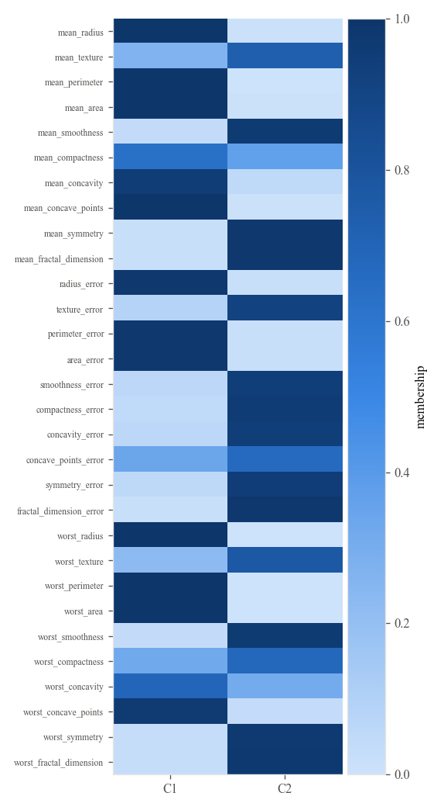
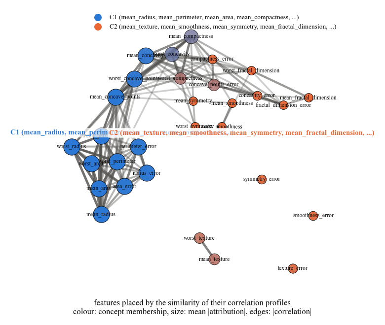
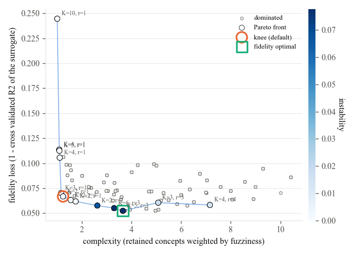
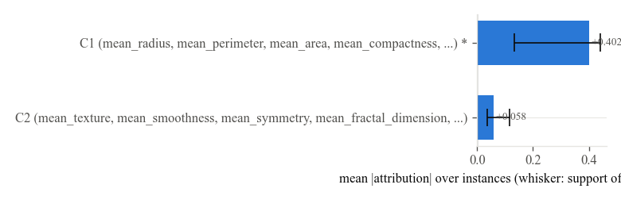
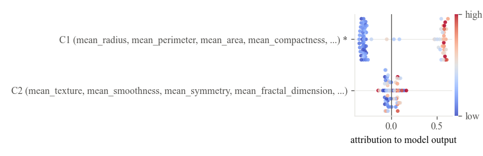
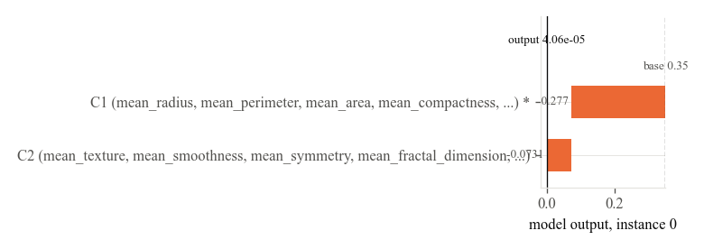
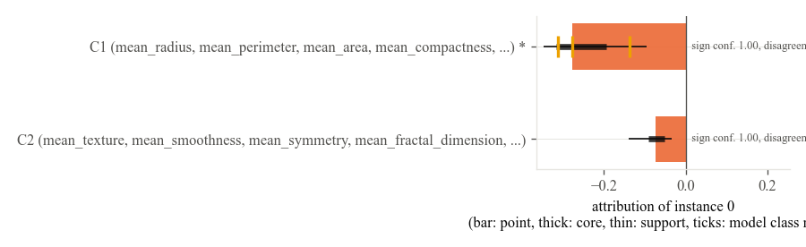
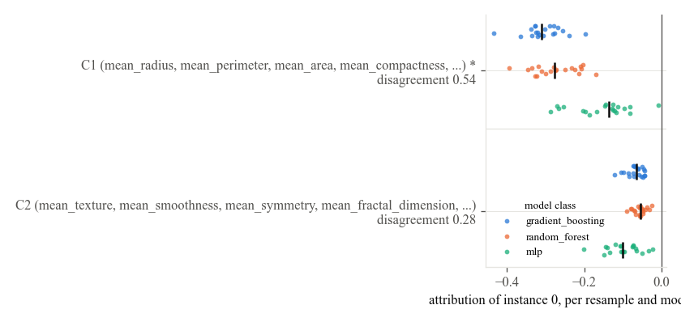
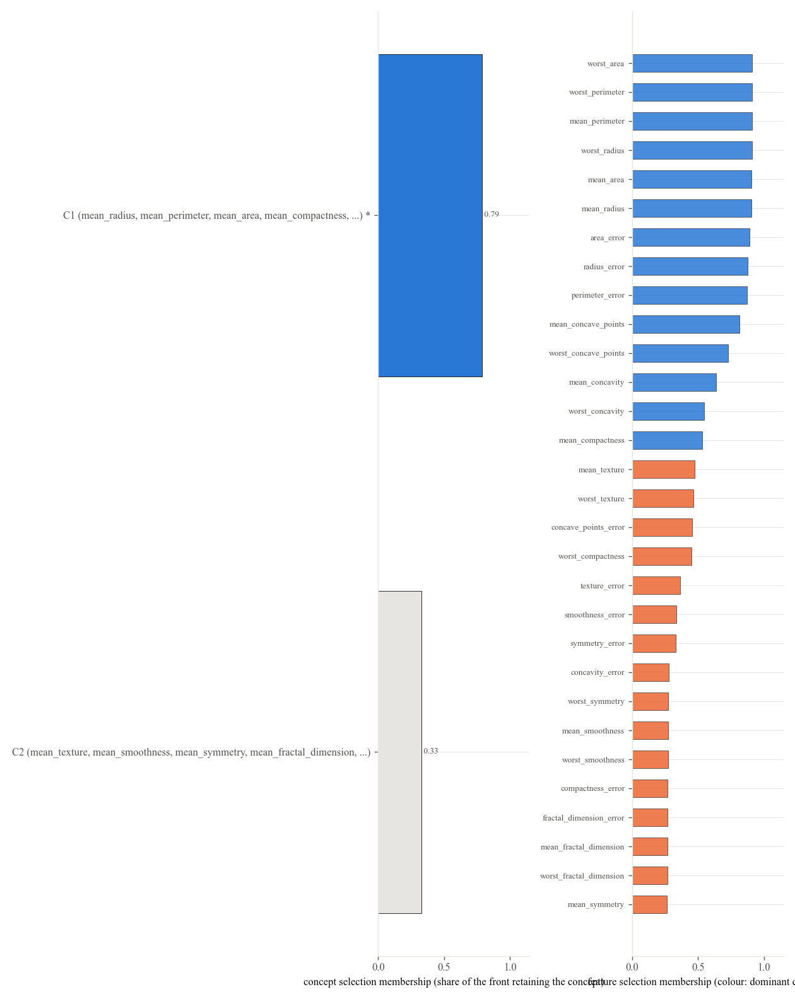

# Binary classification with known feature groups

The script of this tutorial is `examples/classification_breast_cancer.py`.

The Wisconsin breast cancer data distributed with scikit-learn has 569 instances and 30 features: ten characteristics of the cell nuclei, each measured as a mean, a standard error and a worst value. The three measurements of one characteristic are strongly correlated, so the data has ten natural groups, and the question for an explanation method is whether it attributes the diagnosis to characteristics rather than splitting the credit among three copies of the same information.

## Known groups as a candidate partition

```python
--8<-- "examples/classification_breast_cancer.py:data"
```

```python
--8<-- "examples/classification_breast_cancer.py:fit"
```

Two things are new compared with the regression tutorial. `apriori_groups` hands the ten characteristics to the explainer as a candidate partition, which competes on the front with the data driven partitions of two to six concepts (`partition_source="both"`). `target_class=0` says which class probability is explained; the classes of the fitted explainer are in `explanation.attribution.classes` and the explained one in `explanation.attribution.explained_class`.

## The partition the data suggest

```python
--8<-- "examples/classification_breast_cancer.py:plots"
```




The data driven partition is much coarser than the ten characteristics. One concept gathers the size and shape measurements (radius, perimeter, area, concavity and concave points, as means and as worst values), the other texture, smoothness, symmetry, fractal dimension and most of the standard errors. The a priori partition with ten groups is on the front too (the member with K=10 at the top left of the front plot), but it reproduces the model output worse with one retained group, and the knee prefers the two concept partition, which retains one concept, the size and shape one.



## Which concepts drive the probability of malignancy




## One patient





## Robustness across the front



## The HTML card

```python
--8<-- "examples/classification_breast_cancer.py:html"
```

`as_html` returns a self contained card with the bars, the labels, the supports and the sign confidence of one instance; `show_in_notebook` displays it in Jupyter.
