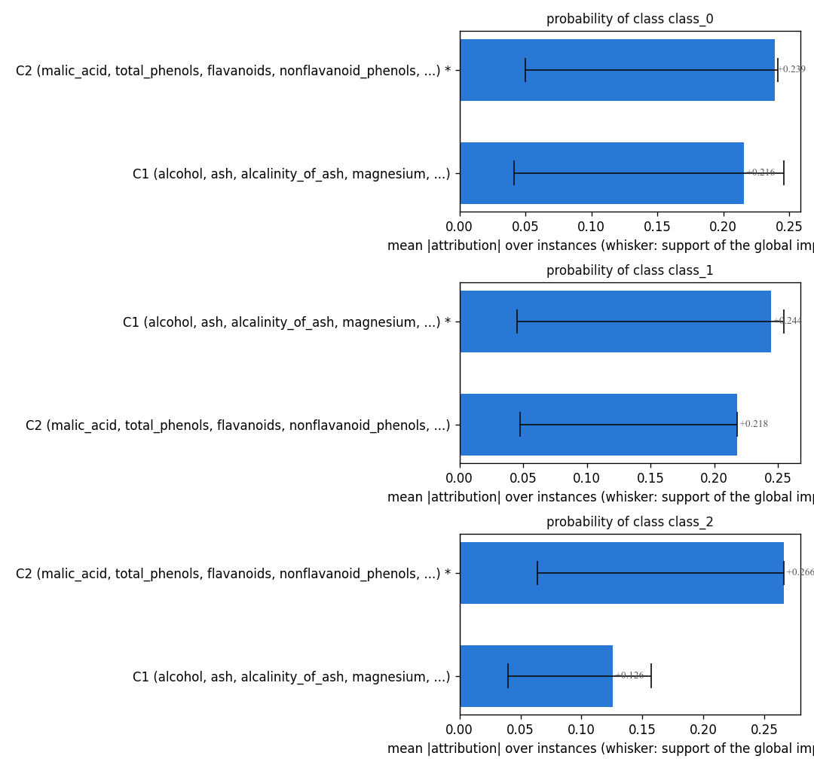
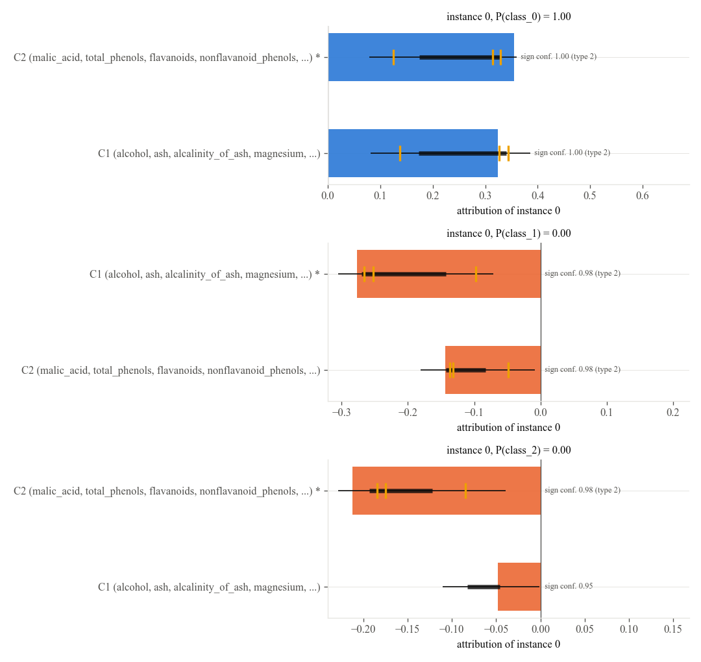
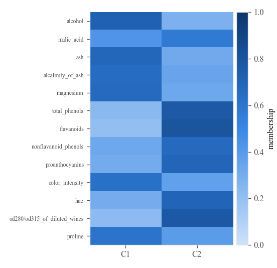
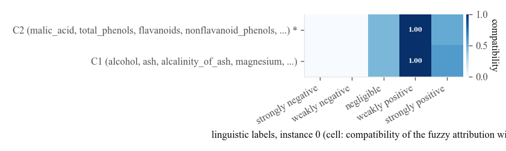
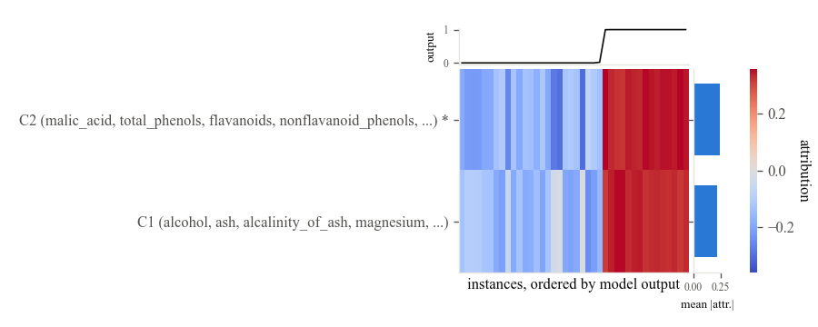

# More than two classes

The script of this tutorial is `examples/multiclass_wine.py`.

SPARC explains a scalar model output. For a classifier that output is the predicted probability of one class, so a problem with several classes is explained one class at a time, with `target_class` naming the class. The wine recognition data of scikit-learn (178 instances, 13 features, 3 cultivars) serves as the example.

```python
--8<-- "examples/multiclass_wine.py:data"
```

```python
--8<-- "examples/multiclass_wine.py:fit"
```

Every explainer trains the same kind of pool on the same data and differs only in the class whose probability is explained; the concept partitions are formed from the features alone, so the three explanations share the same candidate partitions and can be read side by side.

```python
--8<-- "examples/multiclass_wine.py:plots"
```

## Concept importance per class



## One instance, three class probabilities

The same wine, explained for every class. The concepts that raise the probability of its class lower the probabilities of the others, and the sign confidence tells how reliably.



## The partition and the labels





!!! note "Gradient boosting with several classes"
    A scikit-learn gradient boosting classifier with more than two classes is explained with the permutation estimator rather than the exact tree estimator, which is slower. Random forests and histogram gradient boosting are explained exactly for any number of classes.
